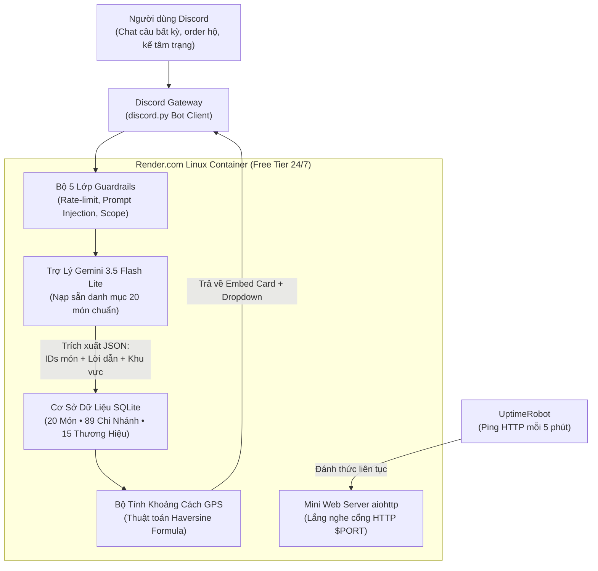
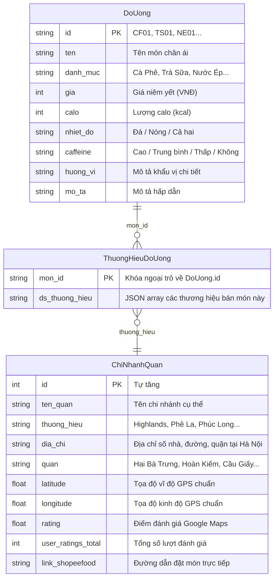

# TÀI LIỆU TOÀN CẢNH & ĐẶC TẢ KIẾN TRÚC HỆ THỐNG BOT MIJUSHI

> **Dành cho kỹ sư & các mô hình AI tiếp nhận ngữ cảnh dự án**  
> *Tài liệu mô tả chi tiết bài toán, ngăn xếp công nghệ, thiết kế cơ sở dữ liệu, các điểm nối kỹ thuật (technical integration), cơ chế bảo vệ và hạ tầng vận hành đám mây 24/7.*

---

## 1. TỔNG QUAN DỰ ÁN & ĐỊNH VỊ THƯƠNG HIỆU

### 1.1. Tuyên ngôn sản phẩm
**Mijushi** là trợ lý trí tuệ nhân tạo (AI Assistant) chạy trên nền tảng Discord, chuyên tư vấn, thấu cảm tâm trạng và gợi ý đồ uống chuẩn gu theo ngữ cảnh cá nhân hóa, đồng thời tự động định vị các chi nhánh quán cà phê/trà sữa gần nhất tại Hà Nội.

> [!IMPORTANT]
> **Định vị cốt lõi (Core Persona Rule)**:  
> **Mijushi KHÔNG PHẢI LÀ TIỆM BÁN NƯỚC VÀ KHÔNG PHẢI NHÂN VIÊN PHA CHẾ!**  
> Mijushi là **Nền tảng tổng hợp & gợi ý đồ uống thông minh**. Bot luôn xưng hô là `"mình"` và gọi người dùng là `"bạn"`, phong cách trẻ trung, ấm áp, tinh tế và thấu hiểu.

### 1.2. Mục tiêu kỹ thuật cốt lõi
1. **Trí tuệ nhân tạo thuần khiết 100% (Pure LLM Reasoning)**: Loại bỏ các bộ phân loại từ khóa cứng (hard-coded keyword classifiers) hoặc vector thô sơ; trao toàn quyền phân tích ngữ nghĩa, hiểu tâm lý và lựa chọn món cho Google Gemini.
2. **Chống ảo giác tuyệt đối (Anti-Hallucination)**: Không để Gemini tự do bịa ra món ăn hay địa chỉ quán ma trên mạng; toàn bộ dữ liệu gợi ý và tọa độ quán được neo chặt (grounded) vào cơ sở dữ liệu SQLite thật tại Hà Nội.
3. **Kiến trúc đám mây 0đ (Zero-Cost 24/7 Production)**: Chạy hoàn toàn trên hạ tầng miễn phí (Render Free Tier + Google AI Studio Free Tier + UptimeRobot) mà không bao giờ bị rơi vào trạng thái ngủ đông (sleep) hay tốn chi phí duy trì.

---

## 2. BỐI CẢNH BÀI TOÁN & GIẢI PHÁP KIẾN TRÚC



### Các thách thức kỹ thuật then chốt & Cách giải quyết:

1. **Thách thức 1: Ephemeral Disk của Render vs Lưu trữ CSDL**
   * *Vấn đề*: Render Free sử dụng container tạm bợ (Ephemeral Storage), mỗi khi container khởi động lại thì mọi file mới tạo sẽ bị xóa sạch về trạng thái Git ban đầu.
   * *Giải pháp*: Bot Mijushi là hệ thống **Chỉ Đọc (Read-Only Recommendation Engine)**. Toàn bộ 20 món và 89 chi nhánh quán được đóng gói cố định trong file SQLite `Cơ Sở Dữ Liệu Đồ Uống.db` và commit trực tiếp lên Git. Bot chỉ thực hiện truy vấn `SELECT`, không ghi dữ liệu lúc runtime $\rightarrow$ **Hoàn toàn không cần nối CSDL đám mây bên ngoài (như Aiven hay Supabase)**, đạt độ trễ truy vấn xấp xỉ `0ms`.

2. **Thách thức 2: Cơ chế Ngủ đông (Sleep sau 15 phút) của Render**
   * *Vấn đề*: Render Free sẽ ép tắt container nếu sau 15 phút không nhận được lượt truy cập HTTP nào, làm tiến trình Bot Discord bị offline.
   * *Giải pháp*: Chạy một web server mini `aiohttp` song song bên trong file `Khởi Chạy Bot.py` trên cùng event loop của asyncio, mở cổng `$PORT` do Render cấp. Kết hợp với **UptimeRobot** gửi HTTP GET ping định kỳ **5 phút/lần** $\rightarrow$ Container duy trì trạng thái thức 24/7 vĩnh viễn.

3. **Thách thức 3: Hiểu ngữ nghĩa tự nhiên vs Chống ảo giác dữ liệu**
   * *Vấn đề*: Nếu cho AI sinh văn bản tự do, AI sẽ bịa ra món không có quán bán. Nếu dùng vector search/regex cứng, bot sẽ không hiểu được các câu nói lóng, nói đùa, gọi hộ bạn bè (`order cho @Anh Meo 1 ly cafe`).
   * *Giải pháp*: Nạp trực tiếp toàn bộ 20 món chuẩn kèm mã ID (`CF01`, `TS01`...) vào System Prompt của Gemini. Gemini đóng vai trò **Bộ phân tích và Bộ chọn ID (Reasoner & Selector)**, xuất ra danh sách ID món chuẩn xác $100\%$. Sau đó SQLite lấy ID đó để map sang các quán có thật ngoài đời.

---

## 3. THIẾT KẾ CƠ SỞ DỮ LIỆU (SQLITE SCHEMA)

Hệ thống sử dụng cơ sở dữ liệu SQLite cục bộ (`Cơ Sở Dữ Liệu Đồ Uống.db`) gồm 3 bảng quan hệ chặt chẽ:



### Chi tiết các bảng:
* **`DoUong` (20 món đại diện)**: Chia làm 6 nhóm: Cà Phê (4 món), Trà Sữa (4 món), Trà Hoa Quả (4 món), Đá Xay (3 món), Nước Ép (3 món), Thư Giãn (2 món).
* **`ChiNhanhQuan` (89 chi nhánh thật)**: Phủ đều 6 quận trung tâm Hà Nội:
  * Hai Bà Trưng: 20 chi nhánh (đặc biệt cụm Bách Khoa - Trần Đại Nghĩa - Lê Thanh Nghị cách trường chỉ từ 69m - 298m).
  * Hoàn Kiếm: 19 chi nhánh (Phố Cổ, Hồ Gươm, Tràng Tiền).
  * Đống Đa: 15 chi nhánh (Chùa Bộc, Xã Đàn, Thái Hà).
  * Thanh Xuân: 13 chi nhánh (Vũ Tông Phan, Nguyễn Trãi, Royal City).
  * Cầu Giấy: 13 chi nhánh (Xuân Thủy, Duy Tân, Trung Hòa).
  * Ba Đình: 9 chi nhánh (Kim Mã, Liễu Giai, Giảng Võ).
* **`ThuongHieuDoUong` (Mapping 15 thương hiệu)**: Gồm *Highlands Coffee, Phê La, Phúc Long, Katinat, Cộng Cà Phê, The Coffee House, TocoToco, Mixue, Ding Tea, Gong Cha, The Alley, AHA Coffee, All Day Coffee, Giảng Cà Phê, Cà Phê Muối Chú Long*.

---

## 4. CHI TIẾT CÁC ĐOẠN KHỚP NỐI KỸ THUẬT (INTEGRATION PIPELINE)

Đây là các điểm nối mã nguồn quyết định sự vận hành trơn tru của hệ thống:

### 4.1. Khớp nối 1: Nhận tin nhắn Discord & Bộ lọc Guardrails
* **File phụ trách**: `Khởi Chạy Bot.py` (`on_message`)
* **Cơ chế**:
  1. Kiểm tra tin nhắn thuộc kênh riêng tư (DM), kênh chỉ định (`#chỉ-dẫn-gọi-nước`), hoặc có `@Mijushi`.
  2. Bóc tách chuỗi sạch: `clean_text = message.clean_content.replace(f"@{bot.user.name}", "").strip()`.
  3. **Guardrail 1 (Rate Limit)**: Khóa 3 giây/user. Nếu bấm liên tục, bot trả về thông điệp nhấn mạnh thương hiệu:
     > *"Chờ xíu nha, Mijushi đang tìm đồ uống nè! Mình là chỗ gợi ý đồ uống chứ đâu phải quán bán nước đâu mà bấm lẹ dữ dị nè 🍹"*

### 4.2. Khớp nối 2: Não bộ Gemini tiếp nhận & Sinh JSON có cấu trúc
* **File phụ trách**: `Trợ Lý Gemini.py` (`TroLyGemini.xu_ly_tin_nhan`)
* **Endpoint**: `https://generativelanguage.googleapis.com/v1beta/models/{model_name}:generateContent?key={API_KEY}`
* **Model ưu tiên**: `gemini-3.5-flash-lite` (phản hồi siêu tốc ~0.8s), tự động fallback sang `gemini-3.5-flash`.
* **Cấu hình Payload**:
  * `responseMimeType: "application/json"`
  * `temperature: 0.4` (giảm sáng tạo ngẫu nhiên, tăng tính chuẩn xác lựa chọn món).
  * `timeout: 25` (phòng ngừa nghẽn mạng quốc tế).
  * `systemInstruction`: Chứa trọn vẹn danh mục 20 món và luật phân loại 2 trường hợp:
    * `CHIT_CHAT`: Chào hỏi, tán gẫu, từ chối khéo các câu hỏi ngoài phạm vi (code, toán, 18+).
    * `GOI_Y_DO_UONG`: Trả về JSON chứa `danh_sach_id_mon` (tối đa 4 mã ID), `ly_do_chon` (lý do riêng cho từng món), `loi_nhan` (lời dẫn chuyện đồng cảm), và `khu_vuc` (địa danh Hà Nội nhận diện được).

### 4.3. Khớp nối 3: Ánh xạ ID món sang CSDL & Tính khoảng cách Haversine
* **File phụ trách**: `Khởi Chạy Bot.py` phối hợp `Cơ Sở Dữ Liệu.py`
* **Quy trình khớp nối**:
  1. Bot đọc danh sách ID từ Gemini: `danh_sach_ids = phan_tich.get("danh_sach_id_mon", [])`.
  2. Truy vấn trực tiếp hàm `csdl.lay_do_uong_theo_id(mid)` để lấy đầy đủ: Giá, Calo, Nhiệt độ, Hương vị, Mô tả.
  3. Gắn kèm lý do chọn do Gemini tự sinh: `ly_do_map.get(mid)`.
  4. Xác định tọa độ người dùng: Ánh xạ từ `khu_vuc` của Gemini sang `VI_TRI_MAC_DINH` (mặc định Bách Khoa: `21.0056, 105.8433`).
  5. Khi người dùng bấm Dropdown chọn món cụ thể $\rightarrow$ Hàm `csdl.tim_quan_ban_mon(mon_id, user_lat, user_lon, top_k=2)` được kích hoạt:
     * Đọc `ThuongHieuDoUong` để biết các thương hiệu bán món này.
     * Quét toàn bộ chi nhánh của các thương hiệu đó trong `ChiNhanhQuan`.
     * Áp dụng công thức **Haversine**:
       $$\Delta\sigma = 2 \arcsin \sqrt{\sin^2\left(\frac{\Delta\phi}{2}\right) + \cos\phi_1 \cos\phi_2 \sin^2\left(\frac{\Delta\lambda}{2}\right)}$$
       $$d = R \cdot \Delta\sigma \quad (R = 6.371.000\text{ m})$$
     * Sắp xếp và lấy ra 2 quán gần người dùng nhất (kèm khoảng cách hiển thị mét/km, rating Google Maps, địa chỉ và nút link mở ShopeeFood).

### 4.4. Khớp nối 4: Render Keep-Alive & Web Server song song
* **File phụ trách**: `Khởi Chạy Bot.py` (`on_ready`)
* **Đoạn mã cốt lõi**:
  ```python
  # Khởi động aiohttp web server mini ngay trong on_ready() của bot
  app = web.Application()
  async def handle_ping(request):
      return web.Response(text="🍹 Mijushi Bot is Running 24/7!\nConnected to Discord Gateway & Google Gemini AI.")
  app.router.add_get("/", handle_ping)
  runner = web.AppRunner(app)
  await runner.setup()
  port = int(os.environ.get("PORT", 10000))
  site = web.TCPSite(runner, "0.0.0.0", port)
  await site.start()
  ```
* **Cơ chế**: Bot vừa giữ kết nối WebSocket hai chiều với Discord Gateway, vừa mở cổng TCP HTTP tiếp nhận gói ping từ UptimeRobot.

---

## 5. BỘ 5 LỚP HÀNG RÀO BẢO VỆ (5-TIER GUARDRAILS)

| Lớp Guardrail | Vị trí thực thi | Bản chất & Hành vi |
| :--- | :--- | :--- |
| **1. User Cooldown & Anti-Spam** | `Khởi Chạy Bot.py` | Giới hạn 3 giây/user trong RAM (`THOI_GIAN_CHAT_CUOI`). Chặn spam request làm tràn hạn mức API. |
| **2. Anti-Prompt Injection** | `Trợ Lý Gemini.py` | System prompt khóa cứng cấm tiết lộ prompt hệ thống, API key, file nội bộ kể cả khi bị ép lệnh `ignore previous instructions`. |
| **3. Scope Guardrail (Giới hạn phạm vi)** | `Trợ Lý Gemini.py` | Từ chối khéo léo các yêu cầu viết code, giải toán, chính trị, 18+; duyên dáng hướng người dùng về một ly nước thư giãn. |
| **4. Google Safety Thresholds** | `Trợ Lý Gemini.py` | Cấu hình `BLOCK_MEDIUM_AND_ABOVE` cho 4 danh mục độc hại: Harassment, Hate Speech, Sexually Explicit, Dangerous Content. |
| **5. Anti-Hallucination (Chống bịa đặt)** | `Cơ Sở Dữ Liệu.py` | Ép $100\%$ dữ liệu món, giá tiền, địa chỉ quán phải lấy từ CSDL SQLite thật, AI không được tự bịa ra menu ảo. |

---

## 6. CẤU TRÚC THƯ MỤC DỰ ÁN (PROJECT MANIFEST)

```
D:\Project\Chatbot For Ordering Drinks\
│
├── Khởi Chạy Bot.py                  # Entrypoint chính: Discord Client, UI Views, aiohttp Web Server
├── Trợ Lý Gemini.py                  # Não bộ AI: Tích hợp Gemini 3.5 API, prompt 20 món, sinh JSON
├── Cơ Sở Dữ Liệu.py                  # Module truy vấn SQLite, thuật toán Haversine định vị quán
├── Bộ Máy Gợi Ý.py                  # Module mở rộng: TF-IDF & Semantic rules (dự phòng/nghiên cứu)
│
├── Cơ Sở Dữ Liệu Đồ Uống.db         # CSDL SQLite: 20 món, 89 quán, 15 thương hiệu tại Hà Nội
├── Dữ Liệu Menu.json                 # Bản sao lưu cấu trúc dữ liệu JSON gốc
│
├── .env                              # Biến môi trường nhạy cảm (ĐÃ ĐƯỢC .gitignore BẢO VỆ TUYỆT ĐỐI)
├── Mẫu Cấu Hình.env                 # File mẫu cấu hình hướng dẫn triển khai
├── .gitignore                        # Chặn lộ token, key, cache, file tạm lên Git
├── requirements.txt                  # Danh sách thư viện Python chuẩn cho Render
│
├── .github/
│   └── workflows/
│       └── Giữ Bot Luôn Thức.yml     # GitHub Actions workflow ping dự phòng
│
└── Tài Liệu Toàn Cảnh Dự Án.md      # Tài liệu đặc tả kỹ thuật toàn diện này
```

---

## 7. THÔNG SỐ VẬN HÀNH & TRIỂN KHAI ĐÁM MÂY (DEPLOYMENT RUNBOOK)

### 7.1. Cấu hình biến môi trường (Environment Variables)
Cần thiết lập trên Dashboard của Render.com hoặc file `.env` cục bộ:
* `DISCORD_BOT_TOKEN`: Token bot lấy từ Discord Developer Portal.
* `GEMINI_API_KEY`: API Key lấy từ Google AI Studio (`aistudio.google.com`).
* `DISCORD_GUILD_ID`: ID Server Discord test (tùy chọn, để đồng bộ Slash Command tức thì).
* `PORT`: Cổng mạng web server (Render tự động cấp, mặc định local là `10000`).

### 7.2. Thông số Web Service trên Render.com
* **Repository**: `https://github.com/kietminh04/Mijushi-Bot.git`
* **Branch**: `main`
* **Region**: `Singapore (Southeast Asia)`
* **Runtime**: `Python 3`
* **Build Command**:
  ```bash
  pip install -r requirements.txt
  ```
* **Start Command**:
  ```bash
  python "Khởi Chạy Bot.py"
  ```
* **Instance Type**: `Free (0.1 CPU, 512 MB RAM)`
* **Public Web URL**: `https://mijushi-bot.onrender.com`

### 7.3. Cấu hình UptimeRobot (Giữ máy chủ thức 24/7)
* **Monitor Type**: `HTTP(s)`
* **Friendly Name**: `Mijushi Bot`
* **URL**: `https://mijushi-bot.onrender.com`
* **Interval**: `5 minutes` (Gửi request HTTP GET mỗi 5 phút một lần để reset bộ đếm sleep 15 phút của Render).

---

## 8. TÓM TẮT ĐIỂM SÁNG KIẾN TRÚC CHO CÁC MÔ HÌNH AI ĐỌC
1. **Zero Hallucination with Pure LLM Intelligence**: Thay vì dùng LLM sinh text tự do hoặc dùng vector keyword thô cứng, dự án sử dụng LLM như một **Bộ lý luận có cấu trúc (Structured Reasoning Engine)** lựa chọn ID từ danh mục kín 20 món, sau đó liên kết cơ sở dữ liệu quan hệ để sinh giao diện tương tác phong phú (Interactive Discord Components).
2. **Optimal Cloud Architecture**: Tối ưu hóa triệt để tài nguyên đám mây miễn phí, xử lý dứt điểm các rào cản nền tảng (Render Ephemeral Storage & 15-minute Sleep Policy) bằng thiết kế CSDL Read-Only và cơ chế nhúng Web Server song song đa luồng.
